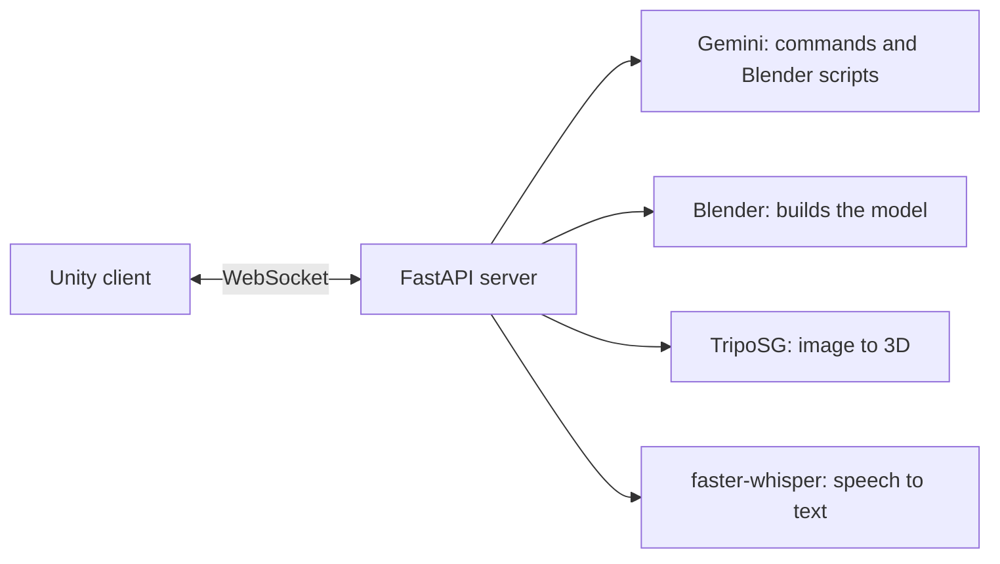

# A.R.K.

Build 3D models with your voice or a photo. A Python server turns requests into 3D models, and a Unity app shows them.

**Status: prototype.** It's being turned into a runnable app. See [issue #3](https://github.com/atinder-harika/ark-model-server/issues/3).

## How it works



- `server/` holds the FastAPI backend.
- `unity-app/` holds the Unity client. See its [README](unity-app/README.md) to run it.

## Why we pivoted

A.R.K. started as a capstone idea: control 3D models by voice and hand, shown on a Pepper's ghost display. An early web prototype tested whether a browser frontend could do the job before committing to Unity. The project then moved to a Unity client backed by this server, which generates the scripts that build each model.

The hand control and Pepper's ghost display were never built.

## Credits

- **Atinder Harika:** server, Blender and AI pipeline
- **Christian Malan:** Unity client

## Limitations and what I'd do next

- The Unity client has known bugs and needs local setup.
- This isn't a Model Context Protocol server yet. Making it one is tracked in [issue #4](https://github.com/atinder-harika/ark-model-server/issues/4).
- Blender must be installed on the same machine as the server.

## Current Scope

Implemented now:

- Gemini-only LLM command and Blender script generation
- TripoSG image-to-3D flow via Hugging Face Space
- Local voice transcription through faster-whisper, with Google SpeechRecognition fallback
- Voice intent routing for `generate_blender` and `edit_unity`
- WebSocket broadcast to Unity clients
- Health smoke testing

Deferred for later:

- Webcam job pipeline

## Quick Start

1. Create and activate a Python virtual environment.
2. Install dependencies:

```bash
cd server
pip install -r requirements.txt
```

3. Ensure `GEMINI_API_KEY` is set for the language model path.
4. Ensure Blender CLI is installed and accessible.
5. Set `GEMINI_API_KEY`, `TRIPOSG_SPACE_URL`, and optionally `TRIPOSG_HF_TOKEN` or `IMAGE_3D_HF_TOKEN` in [server/.env](server/.env).
6. Start API server:

```bash
cd server
python main.py
```

## Key Environment Variables

Set in [server/.env](server/.env):

- `GEMINI_API_KEY` (primary language model key)
- `GEMINI_MODEL` (default: `gemini-2.5-flash`)
- `TRIPOSG_SPACE_URL` (default: `VAST-AI/TripoSG`)
- `TRIPOSG_HF_TOKEN` or `IMAGE_3D_HF_TOKEN` (optional, for private spaces)
- `FASTER_WHISPER_MODEL` (default: `tiny.en`)
- `FASTER_WHISPER_DEVICE` (default: `cpu`)
- `FASTER_WHISPER_COMPUTE_TYPE` (default: `int8`)
- `BLENDER_PATH` (optional if Blender is in PATH)
- `ARK_WAKE_PHRASE` (optional, default `hello ark`)

Image-to-3D uses the configured TripoSG Space directly.

## API Endpoints

Core:

- `GET /health`
- `GET /api/blender-check`
- `POST /api/command`
- `POST /api/generate-obj`
- `GET /api/generation-jobs`

Image-to-3D:

- `POST /api/image-to-3d`
- `GET /api/image-to-3d/jobs`
- `GET /api/image-to-3d/jobs/{job_id}`
- `GET /api/image-to-3d/provider-check`

Voice:

- `GET /api/voice/status`
- `POST /api/voice/start`
- `POST /api/voice/stop`
- `POST /api/voice/analyze`
- `POST /api/voice/audio`

WebSocket:

- `WS /ws`

## Voice And Image Payloads

Voice audio uploads should be `wav`, `flac`, `aiff`, `aif`, or `aifc` files. `POST /api/voice/audio` accepts an uploaded audio file and can optionally auto-process the transcript into a Blender or Unity action.

The backend prefers faster-whisper for transcription and falls back to `SpeechRecognition` if needed.

If the Unity image payload leaves `prompt` empty, the backend derives a simple prompt from the uploaded image name before sending the request to TripoSG.

WebSocket image uploads should use this payload shape:

```json
{
	"type": "image_to_3d",
	"prompt": "reconstruct this object",
	"filename": "object-name",
	"image_name": "photo.jpg",
	"image_base64": "data:image/jpeg;base64,..."
}
```

For voice audio over WebSocket, use:

```json
{
	"type": "voice_audio",
	"audio_name": "voice.wav",
	"audio_base64": "data:audio/wav;base64,...",
	"auto_process": true
}
```

## Run Tests

From repo root:

```bash
.\.venv\Scripts\python.exe -m unittest discover -s server/tests -p "test_*.py"
```

## Notes

- Generated runtime artifacts are written under [server/generated](server/generated).
- Meshes must remain modular; do not join objects during generation.
- Image-to-3D now depends on the configured TripoSG Space.